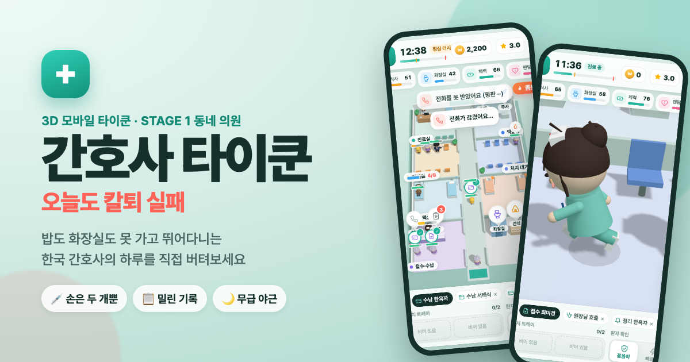
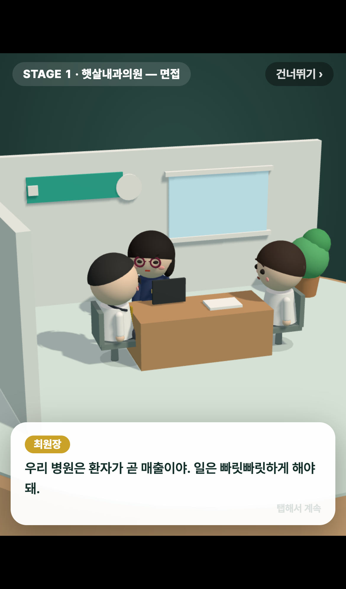
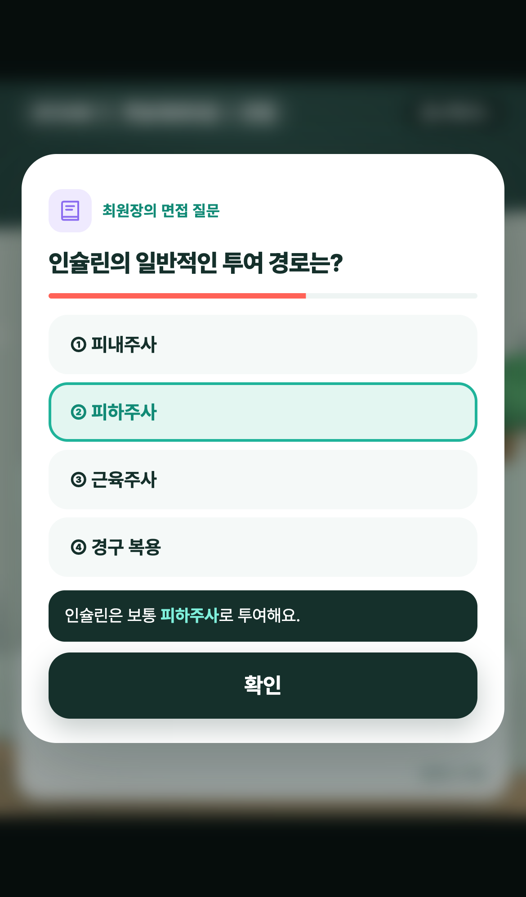
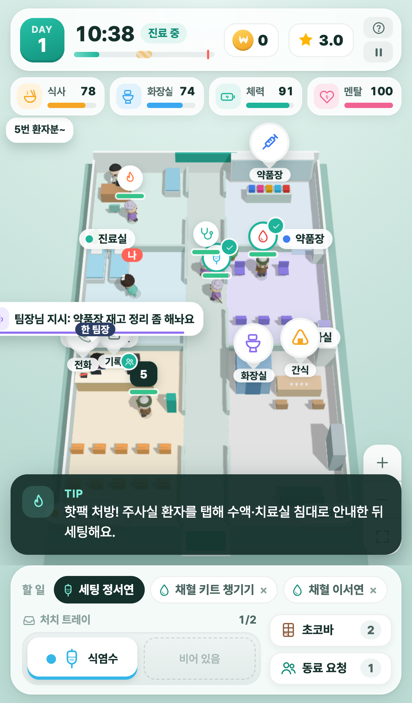
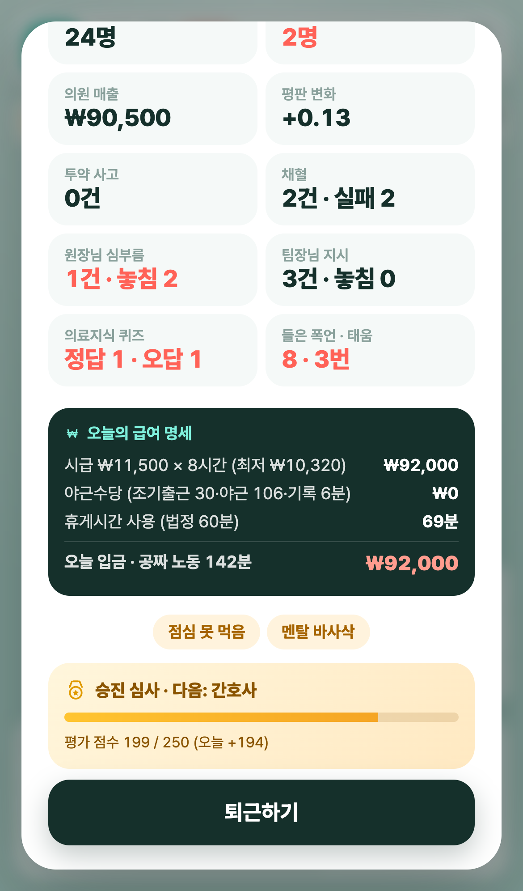
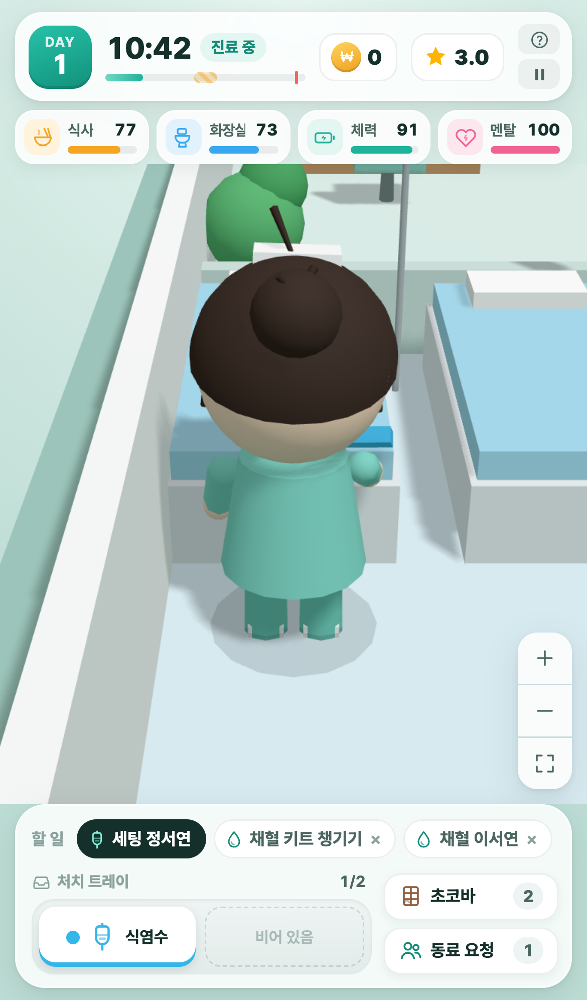
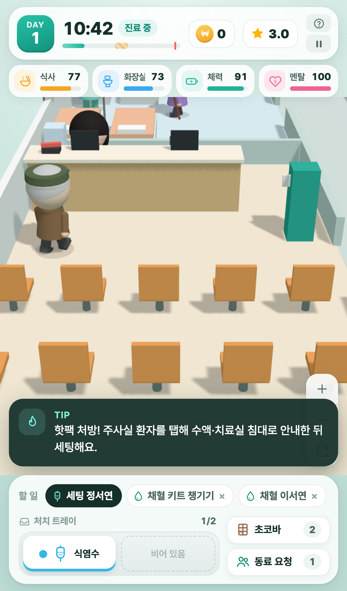
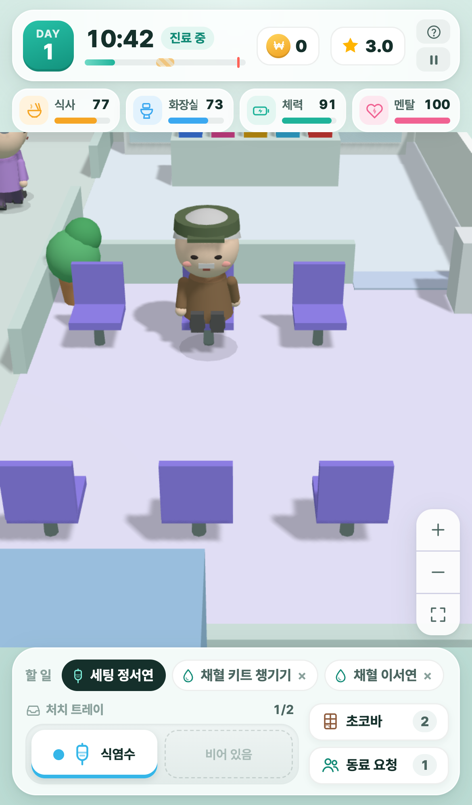
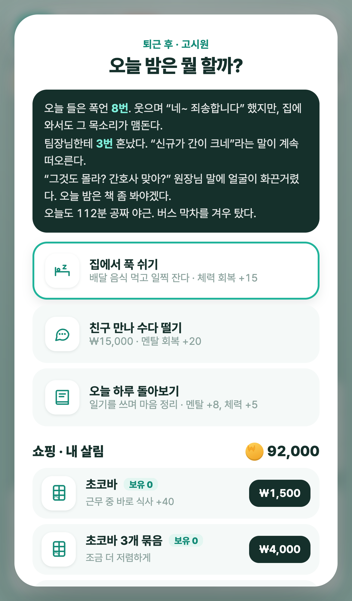

# 👩‍⚕️ 간호사 타이쿤: 오늘도 칼퇴 실패

한국 간호사의 바쁜 하루를 그린 **모바일 3D 시간관리 타이쿤 게임** PoC입니다.
플레이어는 병원장이 아니라 **간호사 본인**이에요. 손(트레이)은 2개뿐이고, 밥·화장실·멘탈도 챙겨야 합니다.



### ▶ [지금 플레이하기](https://fireflower0902.github.io/nurse-tycoon/)

## ▶ 플레이
- **GitHub Pages**: https://fireflower0902.github.io/nurse-tycoon/ (모바일 세로 화면 권장)
- 홈 화면에 추가하면 앱처럼 전체화면으로 실행돼요.
- 로컬 실행: ES 모듈이라 정적 서버가 필요해요
  ```bash
  python3 -m http.server 8000   # → http://localhost:8000
  ```

## 🎮 STAGE 1 · 동네 의원 (3D 쿼터뷰)
진료실 · 약품장 · 주사실 · 수액·치료실 · 접수/수납(대기) · 탕비실이 한 화면에 보이고,
**두 손가락 확대/이동 · 더블탭 확대**가 돼요. 간호사는 복도를 **뛰어다니고**, 환자는 번호표를 뽑고 앉아서 기다립니다.

| 시스템 | 내용 |
|---|---|
| 환자 흐름 | 번호표 → 접수(창구 호출) → 진료(1인씩) → 주사실 대기 → 주사/채혈 또는 수액·핫팩 침대 → 수납 |
| 약 색깔 | 진통제(파랑)·항생제(분홍)·영양수액(노랑)·식염수(하늘)·채혈 키트. 머리 위 색과 다른 약을 쓰면 **투약 사고 → 경위서** |
| 투약 확인 | 놓기 직전 트레이에서 약 선택. 시간 초과 시 첫 번째 약 자동 사용 |
| 채혈 미니게임 | 하루 1~2건. 혈관 잘 보임/안 보임에 따라 성공 구간이 달라지고, 실패하면 환자 분노↑ (진상은 즉시 폭발) |
| 한 팀장(간호팀장) | 같이 일하는 상사. 환자도 직접 보면서 중간중간 **지시**(접수·정리·기록·재고). 원장님께는 싹싹, 나에겐 모질고 근처에서 쉬면 태움. 업무 지정 불가 |
| 후배 동료 | DAY 3 박 선생, DAY 5 이 선생 입사. 접수·수납 / 처치 / 기록 / 알아서 중 업무 지정 가능 |
| 초코바 | 그 자리에서 식사 +40. 팀장님 근처에서 먹으면 태움 |
| 점심시간 | 13~14시 신규 환자 없음. 12:55 막차 환자 이벤트 |
| 최원장(사업가 원장) | 환자가 곧 매출. 점심 30분 컷, 접수 마감 연장, 잦은 호출, **의료지식 기습 질문**. 학회 날엔 대진의(천사·꼼꼼파·속전속결·선 넘는 농담) |
| 의료지식 퀴즈 | 활력징후·주사 각도·투약 5 Right·혈당·채혈 튜브 등 4지선다 10초. 면접·근무 중·아침 조회에서 출제 |
| 스토리 디오라마 | 매 DAY 시작 전 3D 디오라마 컷신. DAY 1 면접(“내일부터 바로 나올 수 있죠?”), 아침 조회, 신입 입사, 매출 회의 |
| 급여 | 시급 ₩11,500(최저 ₩10,320보다 높게) × 8시간, 야근수당 ₩0, 원장님 금일봉 |
| 퇴근 후 | 쉬기 / 친구 만나기 / 하루 돌아보기 · 감정노동 회상 · 투약 사고 시 경위서 |
| 성장 | 상점(초코바·가디건·간호화·텀블러), 집(고시원→원룸→투룸→아파트, 최대치 130), 승진(신규→수간호사) |
| 의원 성장 | 매출이 쌓이면 원장님이 침대·TV 투자 |
| 출근 전 작전 회의 | 오늘의 원장 성향·추천 작전, 동료 업무 미리 지정, 병원 평면도(시설 수·환자 동선)·규모·예상 환자·이벤트, 3D 맵 미리 둘러보기 |

### 실제 현실 반영 (도움말 → 간호사의 현실 탭)
- 병동 간호사 1인당 환자 19.5명(2016), 법적 기준 없음
- 근무 중 업무를 다 못 끝내는 간호사 81.5~92.8% → 밀린 기록
- 하루 2~3시간 공짜 야근, 인계 후 남은 일은 연장근무 불인정 → 무급 야근 정산
- 의사 업무 요구 경험 66.2% → 원장님 호출
- 인권침해 중 폭언 81.0%(가해자 1위 선임 간호사), 피해 후 71.8% 무대응 → 진상 환자·팀장님 태움·멘탈
- 3개월 내 이직 고려 72.1%(2026) → 늘 부족한 인력
- 간호직 폭언·폭행·성폭력 경험 86.3%(2025) → 선 넘는 대진의, 진상 환자

### 캐릭터 (전부 코드로 만든 로우폴리)
- **간호사(플레이어)**: 다크서클, 축 처진 눈, 八자 눈썹, 삐져나온 똥머리, 볼 밴드. 지치면 구부정 + 땀, 화장실 급하면 동동
- **최원장**: 금색 넥타이, 각진 안경 · **대진의 4명**: 성향마다 외형이 달라요
- **한 팀장**: 남색 카디건, 빨간 안경테, 클립보드
- **후배 2명**: 하늘색·분홍색 스크럽
- **환자**: 뽀글 파마 할머니(지팡이), 헌팅캡 할아버지, 정장 직장인, 노란 우비 아이, 마스크 환자, 흉통 환자

## 🗺️ 로드맵
1. **동네 의원** (현재): 예방접종 시즌, 단골 관리 추가 예정
2. **종합병원**: 원무과 데스크와 진료실 앞 간호사 데스크 분리, 병동 다인 담당, 인계, 3교대
3. **대학병원**: 진료과별 테마 에피소드 (응급실, 내과 병동, 외과/수술실, 소아과, 중환자실 …)

## 📸 스크린샷
| 면접 디오라마 | 의료지식 퀴즈 | 근무 중 | 급여 명세 |
|---|---|---|---|
|  |  |  |  |

| 간호사 | 접수·대기 | 주사실 | 퇴근 후 |
|---|---|---|---|
|  |  |  |  |

## 기술
- 바닐라 HTML/CSS/JS + [Three.js](https://threejs.org) (CDN importmap), 빌드 도구 없음
- `game.js`(게임 로직) · `models.js`(3D 캐릭터) · `icons.js`(SVG 아이콘)
- 아이콘은 직접 그린 SVG (`icons.js`), 폰트 Pretendard
- 저장: `localStorage`
