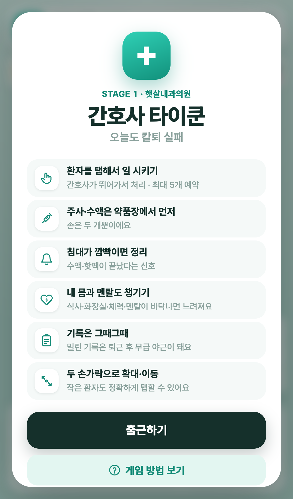
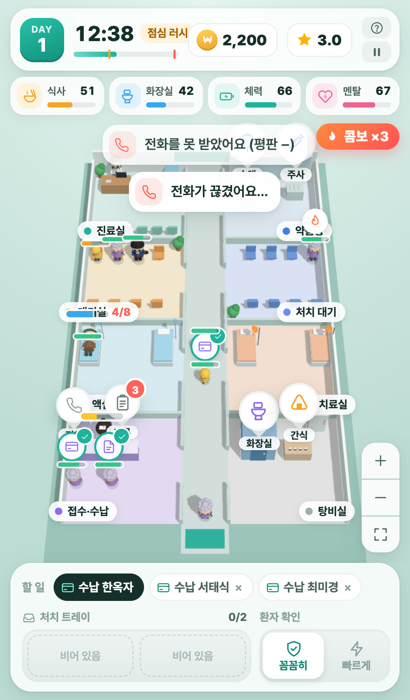
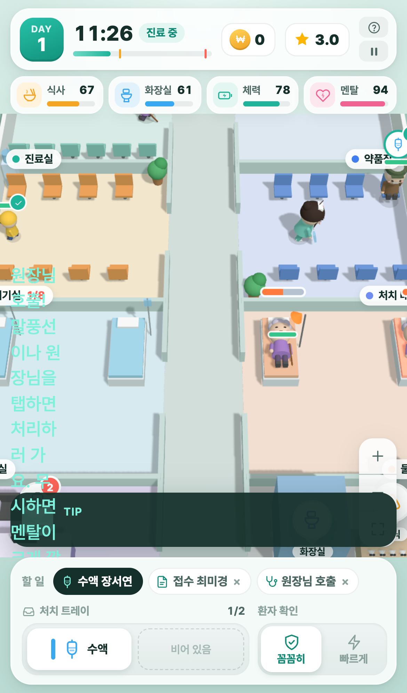
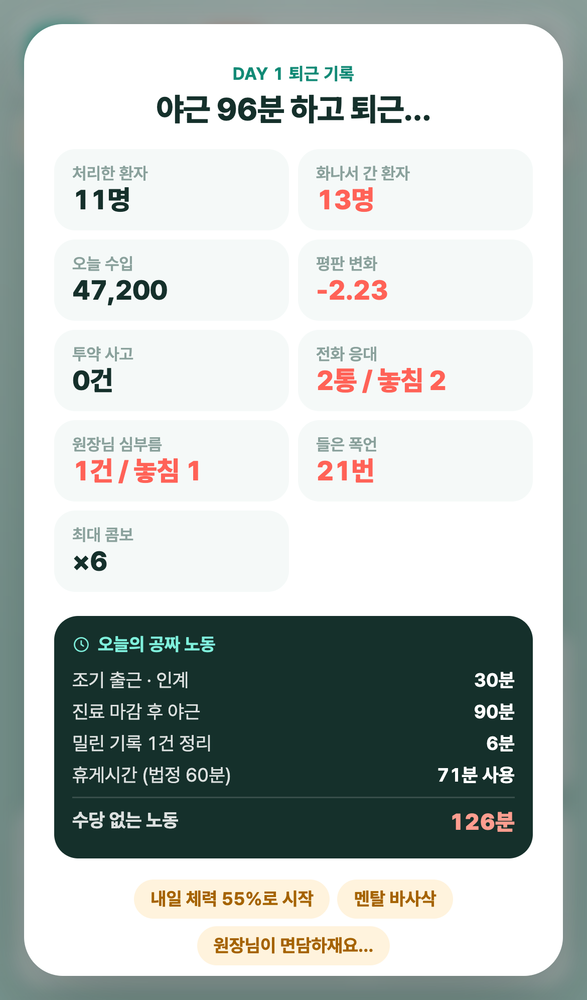
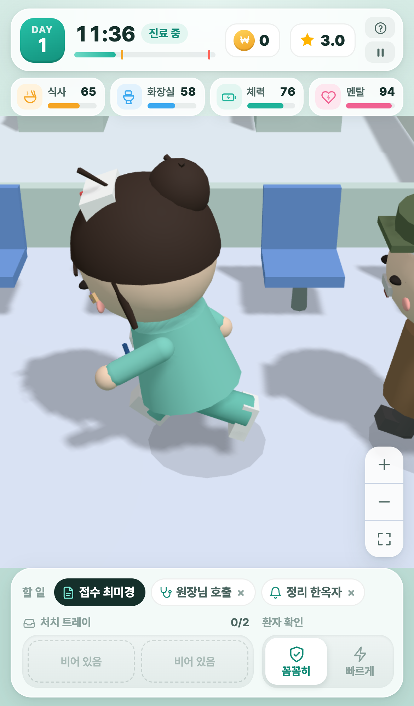
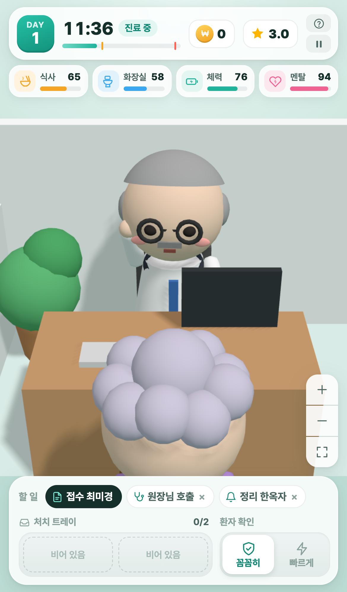
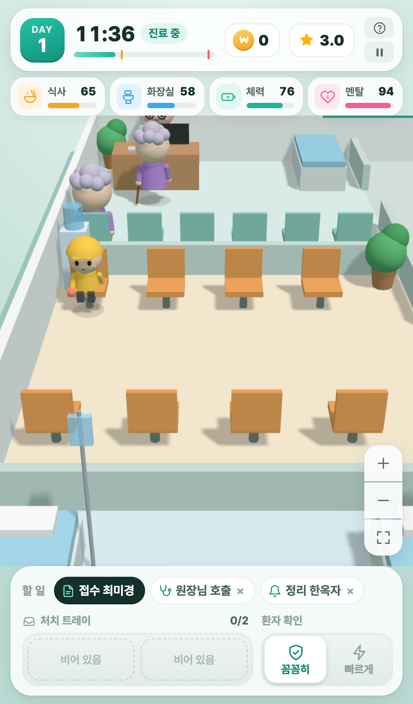
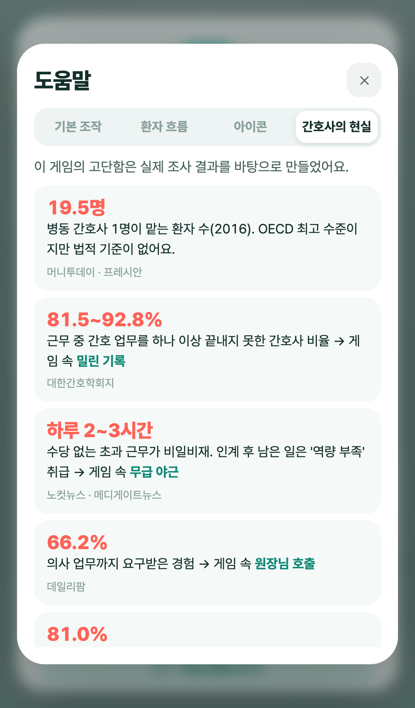

# 👩‍⚕️ 간호사 타이쿤: 오늘도 칼퇴 실패

한국 간호사의 바쁜 하루를 그린 **모바일 3D 시간관리 타이쿤 게임** PoC입니다.
플레이어는 병원장이 아니라 **간호사 본인**이에요. 손(트레이)은 2개뿐이고, 밥·화장실·멘탈도 챙겨야 합니다.


### ▶ [지금 플레이하기](https://fireflower0902.github.io/nurse-tycoon/)

## ▶ 플레이
- **GitHub Pages**: https://fireflower0902.github.io/nurse-tycoon/ (모바일 세로 화면 권장)
- 홈 화면에 추가하면 앱처럼 전체화면으로 실행돼요.
- 로컬 실행: ES 모듈이라 정적 서버가 필요해요
  ```bash
  python3 -m http.server 8000   # → http://localhost:8000
  ```

## 🎮 STAGE 1 · 동네 의원 (3D 쿼터뷰)
진료실 · 약품장 · 대기실 · 처치 대기 · 수액실 · 물리치료실 · 접수/수납 · 탕비실이 한 화면에 보이고,
**두 손가락으로 확대/이동**할 수 있어요. 간호사는 복도를 **뛰어다니고**, 환자는 의자에 앉고 침대에 눕습니다.

| 시스템 | 내용 |
|---|---|
| 환자 흐름 | 대기실 → 접수 → 원장님 진료(자동) → 처치(주사/수액/핫팩) → 수납 |
| 처치 트레이 | 주사·수액은 약품장에서 먼저 챙기기, 최대 2개 |
| 할 일 큐 | 탭한 순서대로 최대 5개 예약, 칩을 탭하면 취소 |
| 내 몸 게이지 | 식사 · 화장실 · 체력 · **멘탈**. 바닥나면 느려지고 실수↑ |
| 환자 확인 | 꼼꼼히(안전) / 빠르게(투약 사고 위험) |
| 기록(차팅) | 처치마다 기록이 쌓이고, 남으면 퇴근 후 **무급 야근** |
| 원장님 호출 | “처방 대신 입력 좀” 같은 잡무 요청. 무시하면 멘탈 −15 |
| 진상 환자 | 기다리는 동안 폭언 → 멘탈 감소 |
| 이벤트 | 점심 직장인 러시, 전화, 흉통 환자 119 연계, 처방 변경, “실비 서류!” 재방문 |
| 퇴근 정산 | 조기 출근 인계 + 야근 + 밀린 기록 = **공짜 노동**, 휴게시간 사용량(법정 60분) |
| 업그레이드 | 침대 추가, 간호화, 대기실 TV, 커피머신 (₩) |

### 실제 현실 반영 (도움말 → 간호사의 현실 탭)
- 병동 간호사 1인당 환자 19.5명(2016), 법적 기준 없음
- 근무 중 업무를 다 못 끝내는 간호사 81.5~92.8% → 밀린 기록
- 하루 2~3시간 공짜 야근, 인계 후 남은 일은 연장근무 불인정 → 무급 야근 정산
- 의사 업무 요구 경험 66.2% → 원장님 호출
- 인권침해 중 폭언 81.0%, 피해 후 71.8% 무대응 → 진상 환자·멘탈
- 3개월 내 이직 고려 72.1%(2026)

### 캐릭터 (전부 코드로 만든 로우폴리)
- **간호사(플레이어)**: 다크서클, 축 처진 눈, 八자 눈썹, 삐져나온 똥머리, 볼 밴드. 지치면 구부정 + 땀, 화장실 급하면 동동
- **원장님**: 흰 가운, 안경, 청진기, 콧수염. 호출할 때 손을 흔들어요
- **환자**: 뽀글 파마 할머니(지팡이), 헌팅캡 할아버지, 정장 직장인, 노란 우비 아이, 마스크 환자, 흉통 환자

## 🗺️ 로드맵
1. **동네 의원** (현재): 예방접종 시즌, 단골 관리 추가 예정
2. **종합병원**: 병동 다인 담당, 인계(미완료 간호 이월), 3교대
3. **대학병원**: 진료과별 테마 에피소드 (응급실, 내과 병동, 외과/수술실, 소아과, 중환자실 …)

## 📸 스크린샷
| 타이틀 | 근무 중 | 확대 | 퇴근 정산 |
|---|---|---|---|
|  |  |  |  |

| 간호사 | 원장님 | 대기실 | 도움말 |
|---|---|---|---|
|  |  |  |  |

## 기술
- 바닐라 HTML/CSS/JS + [Three.js](https://threejs.org) (CDN importmap), 빌드 도구 없음
- 아이콘은 직접 그린 SVG (`icons.js`), 폰트 Pretendard
- 저장: `localStorage`
